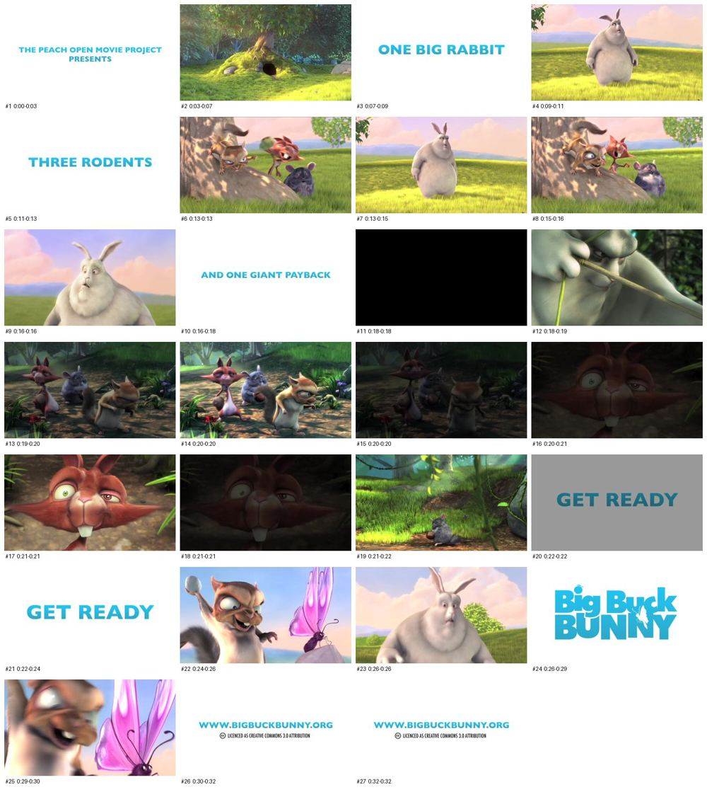

# Video Analyzer

**Turn any video link into a shot-by-shot storyboard.** Every scene's frame, a Claude Vision description of it, the line spoken over it, and an eight-field stylistic fingerprint of the whole video, from one request to your AI assistant.

[](LICENSE)
[](video-analyzer-mcp/pyproject.toml)
[](https://modelcontextprotocol.io)
[](https://mcprush.com/to/brightwayai-video-analyzer-mcp?ref=badge)

> Paste a YouTube, Shorts, TikTok or direct video link and say *"break this down."*
> Video Analyzer finds every cut, looks at each shot, transcribes the audio and hands back the whole storyboard.

<p align="center">
  
  <br>
  <sub>The contact sheet from one <code>video_analyze</code> call on the 33-second <i>Big Buck Bunny</i> trailer: 27 shots, found automatically.<br>
  Big Buck Bunny © Blender Foundation, <a href="https://creativecommons.org/licenses/by/3.0/">CC BY 3.0</a>, <a href="https://peach.blender.org">peach.blender.org</a>.</sub>
</p>

## What you get

| | |
|---|---|
| 🎞️ **Shot-by-shot storyboard** | Every scene with its timestamp, its frame, a production-ready visual description and the dialogue over it, as Markdown and as a Word document |
| 🖼️ **Contact sheet** | Every shot in one image, so you and your assistant see the whole video at a glance |
| ⏱️ **Pacing & hook** | Cuts per minute, shot lengths, time to first cut, words per minute, and exactly what happens in the first 3 seconds |
| 🔤 **On-screen text** | Captions, titles and stickers read off every shot, word for word |
| 🧬 **Stylistic Fingerprint** | Eight labels that pin down the look and feel: rendering, world, characters, narrative, abstraction, density, editing, tone |
| 🗣️ **Transcript** | Timestamped, with music-only stretches left out instead of guessed at |
| 📄 **PDF and Word storyboards** | A storyboard sheet with every frame, ready to send to a client, plus an editable .docx |
| 📦 **Every frame** | As images and as a zip, ready for a deck, a mood board or an editor |
| 🆚 **Compare two videos** | Side-by-side style, pacing and hook, plus what each could borrow from the other |

### Real output

From the same trailer. Each description doubles as a ready-made prompt for AI image and video tools.

| Shot | Time | Visual |
|---|---|---|
| 2 | 0:03–0:07 | 3D animated render, Pixar-style. Sunlit forest meadow with a lush grassy mound, a large tree with exposed gnarled roots on top, and a dark burrow hole beside small gray rocks. Purple wildflowers dot the bright green grass. Soft golden backlight, dappled shadows. |
| 4 | 0:09–0:11 | 3D animated render, Pixar-style CGI. Sunlit green meadow with long yellow-green grass, distant blue-purple hills, soft pink clouds in a lavender sky. Giant chubby gray-white rabbit stands upright, one ear up and one flopped, gazing up curiously. Warm golden lighting. Medium-wide shot. |
| 8 | 0:15–0:16 | 3D animated render, Pixar-style. A tan flying squirrel clings to a tree trunk, wide-eyed and grinning. A red-brown squirrel beside it laughs, buck tooth showing. A chubby gray chinchilla sits in the grass, smiling. Dappled warm light, pink sky. |

```json
"fingerprint": {
  "rendering_class": "Stylized 3D",
  "world_type": "Stylized Real-World",
  "character_strategy": "Mascot-Led (non-human recurring character)",
  "visual_abstraction_index": "2 — Stylized Realism",
  "camera_editing": "Cinematic (depth-of-field, dramatic lighting, camera motion)",
  "tonal_positioning": "Child-Friendly / Whimsical"
}
```

## Who it's for

- **Creators and social teams** working out why a format works: pacing, framing, hooks, tone
- **Explainer studios and instructional designers** matching a reference style shot for shot
- **Agencies** turning competitor and inspiration videos into creative briefs and mood boards
- **Anyone prompting AI image or video tools**, starting from descriptions of shots that already work

## Get started

### Option 1: hosted, nothing to install

Subscribe on mcprush and add it to Claude Code, Claude Desktop, Cursor, ChatGPT or any MCP client. No API keys, FFmpeg or Python on your side: it runs on our server, with YouTube, Shorts, TikTok and direct links supported.

[](https://mcprush.com/to/brightwayai-video-analyzer-mcp?ref=badge)

### Option 2: run it yourself

Needs Python 3.10+, FFmpeg (`brew install ffmpeg` or `apt-get install ffmpeg`) and your own `ANTHROPIC_API_KEY`.

**Claude Code**

```bash
claude mcp add video-analyzer -s user -e ANTHROPIC_API_KEY=sk-ant-... -- \
  uvx --from "git+https://github.com/BrightWayAI/video-analyzer#subdirectory=video-analyzer-mcp" video-analyzer-mcp
```

**Claude Desktop**: add to `~/Library/Application Support/Claude/claude_desktop_config.json`

```json
{
  "mcpServers": {
    "video-analyzer": {
      "command": "uvx",
      "args": ["--from", "git+https://github.com/BrightWayAI/video-analyzer#subdirectory=video-analyzer-mcp", "video-analyzer-mcp"],
      "env": { "ANTHROPIC_API_KEY": "sk-ant-..." }
    }
  }
}
```

To host it for others (Docker, Railway, mcprush gateway), see [the server's README](video-analyzer-mcp/README.md#hosted-mode-remote-http).

## Tools

| Tool | What it does |
|---|---|
| `video_analyze` | The full breakdown: storyboard, contact sheet, fingerprint, pacing & hook, on-screen text, transcript, PDF and Word storyboards, frames |
| `video_extract_frames` | One frame per shot via scene detection (or fixed intervals) with pacing stats, fast, no AI write-up |
| `video_transcribe` | Timestamped transcript (Whisper, runs locally) |
| `video_fingerprint` | Just the eight-field stylistic classification, with pacing stats |
| `video_compare` | Two videos side by side, with a written breakdown of what to borrow (hosted) |
| `video_check_deps` | Checks FFmpeg, Whisper and friends are installed (self-hosted only) |

## The Stylistic Fingerprint

A deterministic classifier over the shot descriptions and transcript, so the same video always gets the same labels.

| Field | Values |
|---|---|
| **Rendering Class** | Live Action, Stylized 3D, Photoreal 3D, Flat 2D, Minimalist Line Art, Textured 2D, Mixed Media |
| **World Type** | Real-World Literal, Stylized Real-World, Abstract Concept Space, Data/Presentation Space, Fictional Metaphor Universe |
| **Character Strategy** | None, Mascot-Led, Single Narrator, Single Protagonist Arc, Ensemble Cast |
| **Narrative Structure** | Direct Explanation, Step-by-Step, Problem → Solution, Analogy, Myth-Busting, Listicle, Character Journey, … |
| **Visual Abstraction Index** | 1 (Photorealistic) to 5 (Maximum Abstraction) |
| **Visual Density** | Minimal, Sparse, Moderate, High |
| **Camera / Editing Language** | Cinematic, Social Vertical Punch, Presentation Deck, Dynamic, Static Slides, … |
| **Tonal Positioning** | Institutional, Corporate Professional, Gen Z Social, Child-Friendly, Dark Editorial |

## How it works

1. **Download**: yt-dlp fetches the video (720p is plenty for analysis)
2. **Find the shots**: PySceneDetect finds every cut, and FFmpeg pulls the middle frame of each shot
3. **Look and listen, in parallel**: Claude Vision describes each frame and reads its on-screen text while faster-whisper transcribes the speech
4. **Write it up**: Claude reads the shots and transcript for reading level and story structure, the fingerprint classifier labels the style, pacing and hook stats come from the shot timings, and the storyboard is written as Markdown, PDF and `.docx`

## Standalone script

The original command-line script lives at the repo root:

```bash
pip install -r requirements.txt
python3 analyze_video.py "https://youtube.com/watch?v=..." --output-dir ./output
```

## License

MIT
